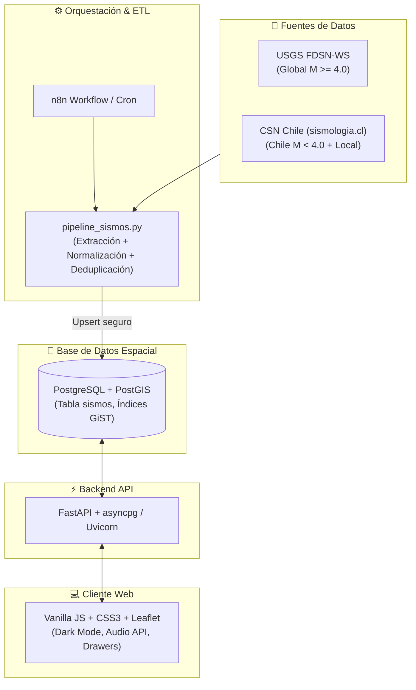

# 🌍 Sismos Web · Plataforma de Monitoreo Sísmico en Tiempo Real

Plataforma web moderna, rápida y de alta precisión para la visualización, monitoreo analítico y cartografía avanzada de eventos sísmicos a nivel global y regional, con cobertura especializada y de alta resolución para **Chile**.

Integrada con una arquitectura de ingesta multi-fuente que combina datos internacionales del **USGS** (*United States Geological Survey*) con el catálogo oficial del **CSN** (*Centro Sismológico Nacional de la Universidad de Chile*).

---

## ✨ Características Principales

### 🗺️ Cartografía y Modos de Visualización
- **Mapas Base Enriquecidos:** Selector interactivo entre *Modo Oscuro*, *Relieve Topográfico (Esri Shaded Relief)*, *Satélite de Alta Resolución* y *Calles (OSM)*.
- **Planisferio sin Repetición de Continentes:** Renderizado limpio de escala mundial con teselas `noWrap: true`, límites estrictos del mundo (`maxBounds`, viscosidad 1.0) y zoom mínimo controlado (`minZoom: 2`), evitando continentes duplicados a los lados.
- **3 Modos de Representación Sísmica:**
  - **Puntos Individuales:** Círculos escalados proporcionalmente por magnitud con código de color dinámico.
  - **Agrupamiento (Clustering):** Condensación de miles de eventos mediante `Leaflet.markercluster` con rendimiento optimizado.
  - **Mapa de Calor (Heatmap):** Densidad sísmica ponderada por severidad usando `Leaflet.heat`.
- **Capa Tectónica Vectorial:** Límites de placas tectónicas globales superpuestas (modelo *PB2002*) con identificación en español (Placa de Nazca, Sudamericana, Cocos, Cinturón de Fuego del Pacífico, etc.).

### ⏱️ Monitoreo en Vivo e Inmediatez
- **Auto-refresco Programable:** Actualización automática cada 1, 2 o 5 minutos con temporizador visual regresivo en vivo (`MM:SS`).
- **Tarjeta de Último Sismo Relevante:** Destacado visual con indicador pulsante, magnitud, profundidad, referencia geográfica y botón de enfoque inmediato en el mapa.
- **Tiempos Relativos Humanizados:** Indicadores en español (*"Hace 4 min"*, *"Hace 2 h"*, *"Ayer"*) calculados dinámicamente en tiempo real.
- **Alertas Sonoras y Toasts:** Campanilla armónica generada vía *Web Audio API* (sin archivos pesados, conmutable con botón 🔔/🔕) y notificaciones flotantes para sismos relevantes ($M \ge 4.5$).
- **Identidad de Marca:** Favicon oficial (`icon_sismos.png`), soporte para `apple-touch-icon` y endpoint `/favicon.ico` integrado en FastAPI.

### 📊 Analítica y Filtrado Avanzado
- **Panel de Filtros Modular por Pestañas:** Separación clara entre *"🎯 Criterios"* (ubicación, fechas, severidad) y *"🗺️ Capas & Leyenda"* (modos de visualización, mapas base, simbología).
- **Selectores Desplegables con Búsqueda en Vivo:** Componentes predictivos para seleccionar país y regiones/comunas escribiendo el nombre.
- **Sincronización Lista $\leftrightarrow$ Mapa:** Al hacer clic en un sismo de la lista, el mapa vuela al epicentro y abre su popup; al tocar un marcador, se resalta y posiciona en la lista.
- **Búsqueda Espacial (Bounding Box):** Botón flotante `🔍 Buscar en esta área` para consultar sismos acotados al visor actual de la pantalla.
- **Histograma Interactivo:** Gráfico de barras por rangos de magnitud ($<3.0$, $3.0\text{–}4.9$, $5.0\text{–}6.4$, $\ge 6.5$) que permite filtrar al instante haciendo clic en cada categoría.
- **Exportación de Datos:** Descarga inmediata en formatos estructurados **CSV** y **GeoJSON**.
- **URLs Compartibles:** Enlaces permanentes con estado en los parámetros de la URL (`?sismo=id`, `?mag_min=...`, etc.) con botón de copiado rápido al portapapeles.
- **Saneamiento UTF-8:** Decodificación automática de caracteres especiales y tildes en referencias del catálogo CSN.
- **Telemetría y Analítica Interna Silenciosa:** Registro asíncrono no bloqueante en PostgreSQL con geolocalización aproximada por IP (país, ciudad, coordenadas estimadas de ISP y dispositivo) y endpoint administrativo `/api/analytics/resumen`.

### 📱 Experiencia Adaptable y Móvil
- **Layout 100% Fluido:** El mapa ocupa todo el espacio disponible sin desbordamientos.
- **Paneles Colapsables / Drawer Táctil:** En computadoras de escritorio los paneles laterales se ocultan para expandir el mapa; en smartphones y tablets ($\le 1024\text{px}$) se abren como cajones táctiles (*slide-over drawers*) con backdrop translúcido.

---

## 🏗️ Arquitectura del Sistema



---

## 🛠️ Stack Tecnológico

| Capa | Tecnologías |
|---|---|
| **Frontend** | HTML5 semántico, Vanilla CSS3 (variables CSS, glassmorphism, responsive drawers), Vanilla JavaScript (ES6+), Leaflet 1.9.4, Leaflet.markercluster, Leaflet.heat, Web Audio API |
| **Backend API** | Python 3.11+, FastAPI, Uvicorn, asyncpg / psycopg2, Pydantic |
| **Base de Datos** | PostgreSQL 16+ con extensión espacial **PostGIS**, índices espaciales GiST y temporales B-Tree |
| **Pipeline ETL** | Python con `requests`, `argparse`, `re`, deduplicación espacio-temporal |
| **Orquestación** | **n8n** / Cron jobs para ejecución continua |
| **Despliegue** | Docker, Docker Compose, aislamiento de privilegios y contenedores seguros |

---

## 🚀 Puesta en Marcha

### 1. Clonar el repositorio
```bash
git clone https://github.com/pototo1991/sismos.git
cd sismos
```

### 2. Configurar variables de entorno
Copia la plantilla `.env.example` y define tus credenciales:
```bash
cp .env.example .env
```

Edita `.env` con los parámetros correspondientes:
```ini
DB_HOST=localhost
DB_PORT=5434
DB_NAME=sismos_db
DB_USER=sismos_user
DB_PASSWORD=TuPasswordSeguraAqui
DB_SSLMODE=prefer
API_PORT=8000
API_BIND=127.0.0.1
ENVIRONMENT=development
```

### 3. Levantar con Docker Compose

* **Modo Desarrollo (con recarga en vivo):**
  ```bash
  docker compose up --build
  ```
  Accede a la aplicación en: `http://localhost:8000`

* **Modo Producción (servidor Knossos u host dedicado):**
  ```bash
  docker compose -f docker-compose.yml up -d --build
  ```

---

## 🔄 Pipeline ETL de Sismos (`pipeline_sismos.py`)

El script `pipeline_sismos.py` se encarga de extraer, validar, normalizar y almacenar los sismos tanto de **USGS** como de **CSN (Chile)**.

### Características del ETL:
* **Multi-Fuente:** Consulta el USGS vía API FDSN-WS y el CSN vía parsing estructurado de catálogo diario.
* **Deduplicación Espacio-Temporal:** Evita duplicar eventos entre USGS y CSN comparando proximidad temporal ($\pm 150\,\text{s}$) y espacial ($\le 0.7^\circ$).
* **PostGIS Ready:** Genera geometrías espaciales `SRID=4326;POINT(lon lat)` para indexación GiST.
* **Resiliencia:** Reintentos automáticos con retroceso exponencial (*exponential backoff*) y registro en `pipeline_sismos.log`.

### Ejecución Manual o vía n8n

```bash
# Modo diario por defecto (últimos 3 días, USGS + CSN):
python3 pipeline_sismos.py --modo diario

# Extraer una ventana de más días (ej. últimos 7 días):
python3 pipeline_sismos.py --modo diario --dias 7

# Ejecutar únicamente la extracción de Chile (CSN):
python3 pipeline_sismos.py --modo diario --fuente csn --dias 3

# Ejecutar únicamente USGS:
python3 pipeline_sismos.py --modo diario --fuente usgs --dias 3

# Carga histórica completa (1964 a la fecha):
python3 pipeline_sismos.py --modo historico
```

### Automatización en n8n
En tu flujo de trabajo de **n8n**, puedes utilizar un nodo **Schedule Trigger** (ej. cada 5 o 10 minutos) conectado a un nodo **Execute Command** o **SSH**:
```bash
python3 /ruta/a/pipeline_sismos.py --modo diario --dias 3
```
El script finaliza con código de salida `0` si fue exitoso o `1` en caso de error, permitiendo activar alertas o reintentos en n8n.

---

## 🧭 Roadmap y Estado del Proyecto

Para conocer el detalle de las fases completadas y las próximas iteraciones (incluyendo la integración de Inteligencia Artificial local con Ollama), consulta el documento:
👉 [ROADMAP.md](ROADMAP.md)

---

## 📄 Licencia

Este proyecto se distribuye bajo la licencia **MIT**. Consulta el archivo `LICENSE` para más información.
